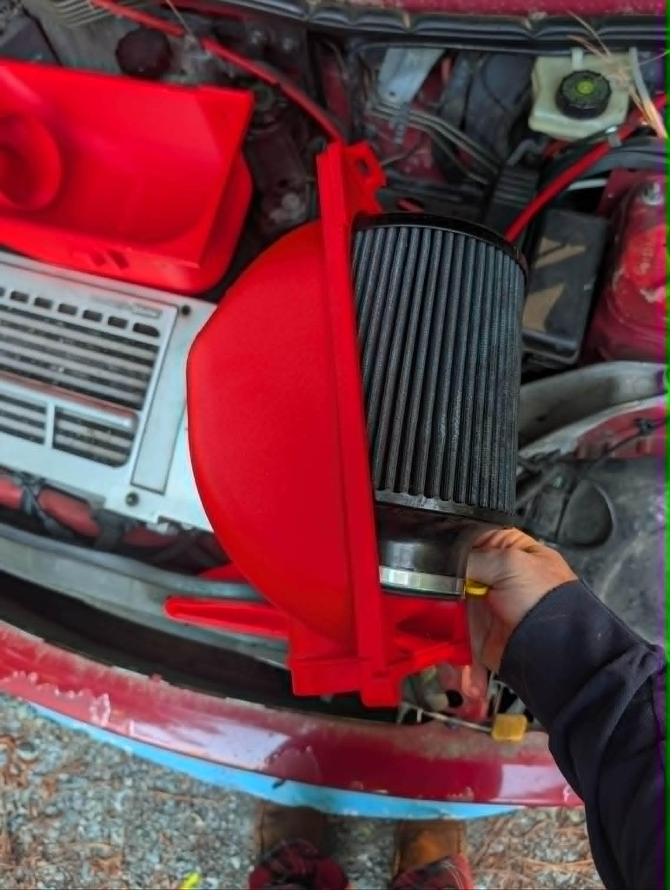
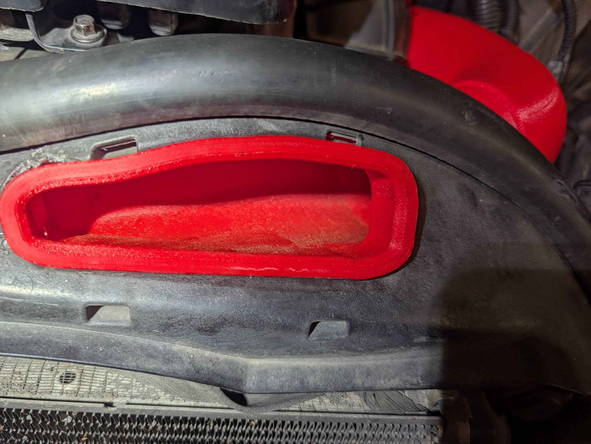
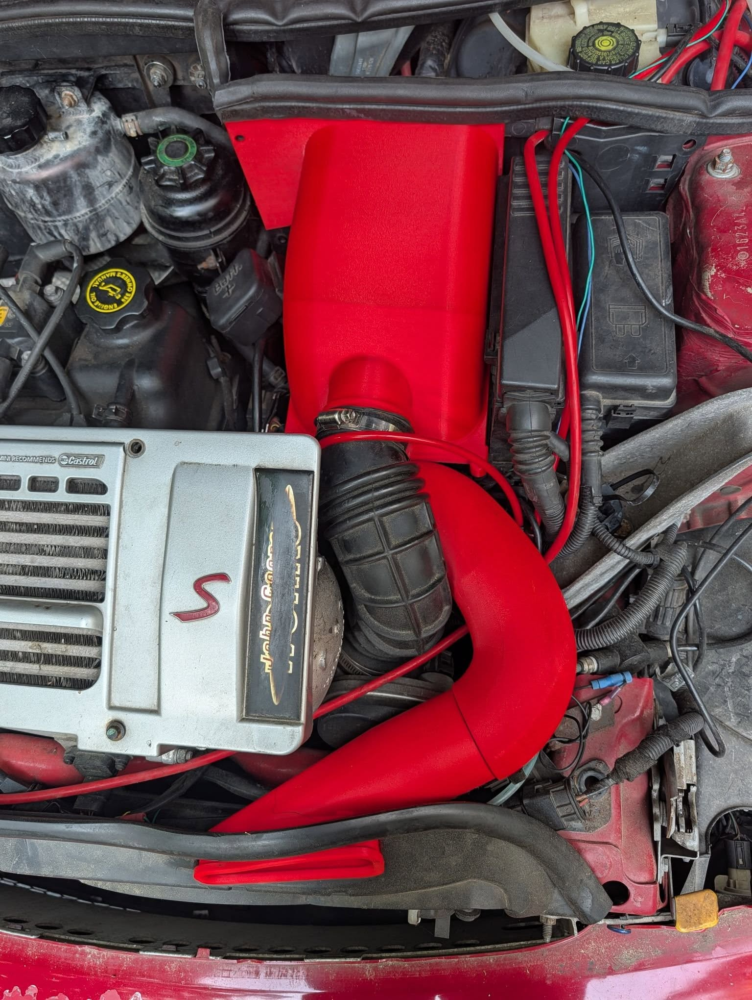

<!--more-->

Since the [airbox writeup](/car/tech/2026/07/11/r53-track-airbox.html) went up, the most common question has been some version of *"I don't have a printer — will you print one for me?"* So yes: I now sell the **R53 airbox and cold-air snorkel as finished printed parts**, not just STLs.

Everything is printed to order on a **Bambu Lab H2S** with an actively heated chamber — the airbox alone is a 12-hour print, the three-piece snorkel another 13.

> **Updated November 16, 2026:** the cold-air snorkel is **$125 in ASA, any color**, or **$80 in PETG**. Shipping is generally **$20 or less**.

## Pricing

The snorkel comes in ASA (any color) or PETG. Airbox prices are being reworked and coming down; email [ryan3ddesigns@gmail.com](mailto:ryan3ddesigns@gmail.com?subject=R53%20airbox%20price) for a current price:

| Part | Material | Price |
|------|----------|-------|
| **Cold-air snorkel** (front section, 3-piece + shroud) | ASA, any color | **$125** |
| **Cold-air snorkel** (front section, 3-piece + shroud) | PETG | **$80** |
| **Airbox** (v4) | ABS-GF / ASA-GF / ASA-CF / PAHT-CF | Email for price |

**Full intake kit: 10% off** the two parts combined.

Shipping is billed at actual cost and is generally **$20 or less**. Color choice is free on the ASA snorkel and on any GF airbox.

{:.img-md}
*Airbox as shipped — filter not included; it takes any 3.5" ID dry cone.*

## Choosing a material

The **snorkel is printed in ASA or PETG**. It sits in the bumper pulling ambient air ahead of the engine and never heat-soaks, so either plastic handles it. ASA comes in any color and stands up best to sun and weather at the mouth; PETG is the budget option.

The **airbox** is where the material choice matters:

| Material | Color options | Airbox |
|----------|---------------|--------|
| **PAHT-CF** | black only | Best choice — max thermal headroom |
| **ASA-CF** | black only | Good — best UV resistance |
| **ABS-GF** | color choices | Good — ~105 °C, adequate in-bay |
| **ASA-GF** | color choices | Good — ~100 °C, UV-resistant |
| **PETG-GF** | — | **Not offered** — heat-soak risk |

Two things drive the choice:

- **Carbon-fiber blends are black; glass-filled blends take color.** Want a color-matched airbox? That's ABS-GF or ASA-GF. Want maximum heat resistance in black? PAHT-CF.
- **The airbox lives in the engine bay.** It sees real heat — an R53 bay with the intercooler over the blower will pass 80 °C on a hot lap and beat that on heat-soak after shutdown, which is why I will not print the airbox in PETG: fiber fill stiffens a part, but it does not raise the temperature the base plastic softens at. **Heat-soak note:** on any non-PAHT airbox, expect the part to see its limits on brutally hot days; PAHT-CF is the no-questions material.

## Fitment

Same parts as the [build post](/car/tech/2026/07/11/r53-track-airbox.html):

- Fits **R53 Mini Cooper S and R52 Cooper S** — v4 clears both partitioned and non-partitioned master-cylinder layouts
- Airbox takes a **3.5" ID dry cone filter** ([Injen X-1021-BB](https://injen.com/i-30497685-injen-technology-supernano-web-dry-air-filter) or equivalent, ~5" base, ~4" top) — filter not included
- Airbox snaps onto the lower factory airbox section with modeled-in tabs
- Snorkel front shroud snaps into the radiator core-support opening and connects toward the airbox through the **factory rubber accordion boot** — the same joint the OEM snorkel uses

{:.img-md}
*Snorkel front shroud seated in the core-support cutout — positive retention, no popped clips.*

{:.img-lg}
*Both parts installed — the whole intake path from core support to throttle body, larger and straighter than stock.*

## The fine print

- **Track / off-road use only.**
- **No warranty against engine damage** — you are buying a printed plastic part for a supercharged engine bay; inspect it at every event like you would any other intake component.
- Shipping is billed at actual cost and is generally **$20 or less**. **AK/HI and international are quoted separately**, as is the full kit (it needs a bigger box).

## How to order

Email [**ryan3ddesigns@gmail.com**](mailto:ryan3ddesigns@gmail.com?subject=R53%20printed%20parts%20order) with the part, material, and color you want and your zip code, and you'll get a shipping quote back.

Prefer to print it yourself? The STLs are still for sale:

| Part | Cults3D | STL price |
|------|---------|-----------|
| **R53 airbox** (v3 + v4 + prototype) | [R53 airbox](https://cults3d.com/en/3d-model/various/r53-airbox) | $50 |
| **Cold-air intake tube / snorkel** | [R53 cold air intake tube](https://cults3d.com/en/3d-model/various/r53-cold-air-intake-tube) | $40 |
