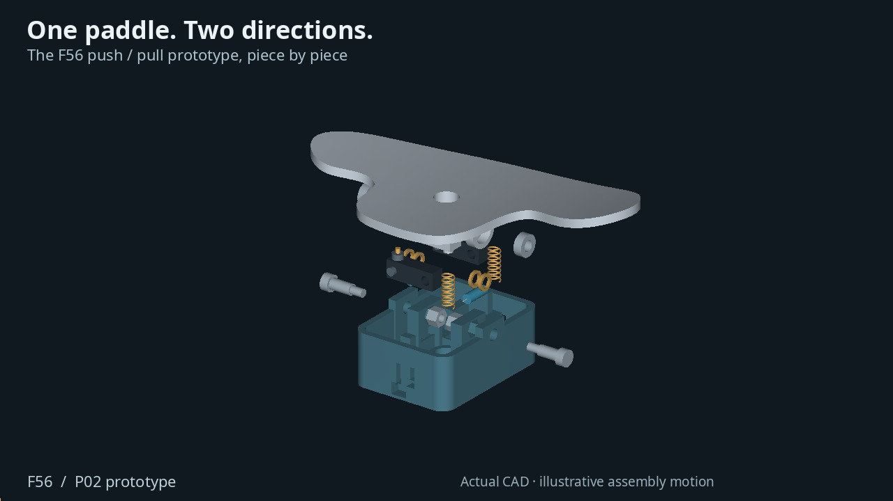
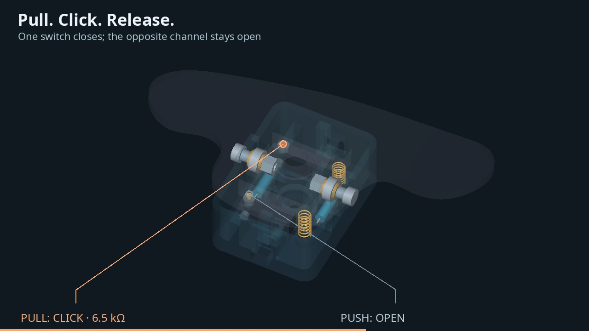

<!--more-->

## One paddle, both shifts

The original paddle on my F56 only pulls. I want the same blade to work in both directions: pull for one shift command, push for the other, with a distinct click and a return to center after each movement.

I used my paddle and wheel-area scans as references for a new SolidCraft prototype. The moving blade sits over a fixed box containing two switches, two return springs and the resistors. I will mirror the printed parts for the other side of the wheel.

## Watch it assemble and click

The animation uses the actual P02 CAD geometry. It brings the components together, then makes the printed shells transparent so the spring movement and individual switch actions are visible.



*The assembly paths are an exploded-view illustration. The click sounds are synthesized cues, not recordings of a finished paddle. The mechanism moves through its nominal CAD travel; this is not a physical test.*

## Small RC parts make a useful pivot

The pivot uses two **MR84ZZ bearings**, each 4 mm inside diameter, 8 mm outside diameter and 3 mm wide. They are ordinary miniature bearings sold for RC cars. **XRAY 372297** shims set the nominal stack on either side of each bearing.

{:.img-lg}
*The bearings sit in the blade. Two short shoulder screws support the pivot from opposite sides of the fixed box.*

The two short screws matter. A shaft running all the way across the box would block the center mounting screw. Keeping the middle open lets a T25 driver pass through the hole in the blade and into the original wheel fastener.

That BMW screw passes through the box and threads into the steering wheel. Its exact shank, head and under-head length still need measuring before I finalize the mounting bore and engagement.

## What happens during a click

Pulling the blade compresses one spring and presses one switch plunger. Pushing it works the opposite side. Both springs stay preloaded in the nominal model, so releasing the blade brings it back toward neutral.

{:.img-lg}
*One channel closes at a time. The springs and plunger movement are animated from the nominal geometry.*

The printed stops limit travel to roughly **6.5 degrees each way**. They are intended to take the end-of-travel load before the switch bottoms out. The spring candidate is **Lee Spring LC 018B 05 M**; the final feel and switch timing will be set on the bench with the actual parts.

The electrical intent is a separate **6.5 kΩ path to ground for each direction**. Both channels should be open at neutral. The connector pinout, signal current and physical upshift/downshift assignment still need checking against the car.

## Parts for one paddle

| Part | Quantity | Starting specification |
|---|---:|---|
| Printed housing and blade | 1 each | PAHT-CF; mirror for the other side |
| [Avid **MR84ZZ** bearings](https://www.avidrc.com/product/p/15/4x8x3-Metal) | 2 | 4 × 8 × 3 mm, non-flanged |
| [XRAY **372297** shims](https://monacorc.com/en/3029-372297-xray-alu-shim-4x6x10mm-10.html) | 4 | 4 × 6 × 1 mm; ten per pack |
| **AMPG STR601M4X8** shoulder screws | 2 | 4 mm shoulder × 8 mm long, M3 thread |
| [**D2HW-C201M** microswitches](https://www.digikey.com/en/products/detail/aratas-america-llc/D2HW-C201M/404504) | 2 | Prewired SPDT pin-plunger type |
| **LC 018B 05 M** springs | 2 | 4.57 mm OD, 12.70 mm free length; candidate for bench testing |
| 6.5 kΩ resistors | 2 | One per channel; verify package and power rating |
| M3 switch screws, washers and plain nuts | 2 each | M3 × 16 screws are the starting length |
| M3 pivot locknuts | 2 | Check pocket fit and thread engagement |
| Original BMW mounting screw | 1 reused | T25 drive; dimensions to confirm |

The pair needs twice these quantities; one ten-pack of the XRAY shims covers both paddles. Heat-shrink, strain relief and the correct wiring terminals complete the electrical assembly. The shoulder screws are not ordinary M3 × 8 screws—the smooth bearing surface is **4 mm** in diameter.

## Printing and the next fit check

I print PAHT-CF with ASA supports on my X2D. The box and blade will be separate prints, assembled around the metal hardware. The current housing measures **38 × 52 × 23 mm**; the blade spans about **116 × 61 mm**.

The exported solids are valid and both printable meshes are watertight. A modeled **8 mm driver** clears the center access path, and the housing/blade motion check reaches the intended stops in both directions. Those checks establish the digital geometry, not the fit or strength of a printed assembly.

Next is a bench print: check the bearing seats and small retaining lips, remove the supports, set the spring feel, and verify that each switch releases cleanly. The wheel mounting surface and anti-rotation fit also need checking. Once those details are right, I can test the complete assembly and its wiring on the car.
