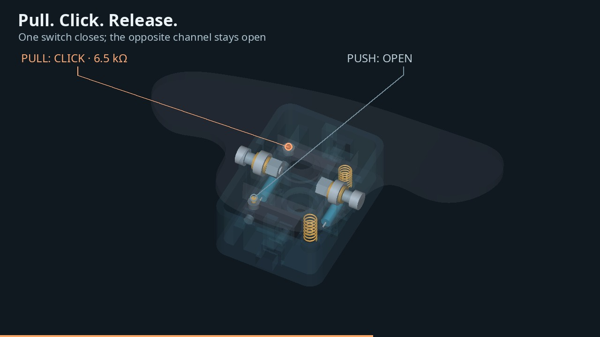
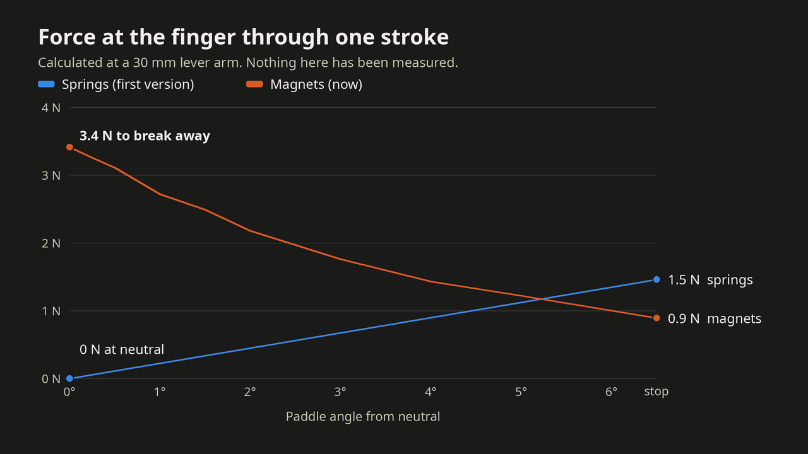
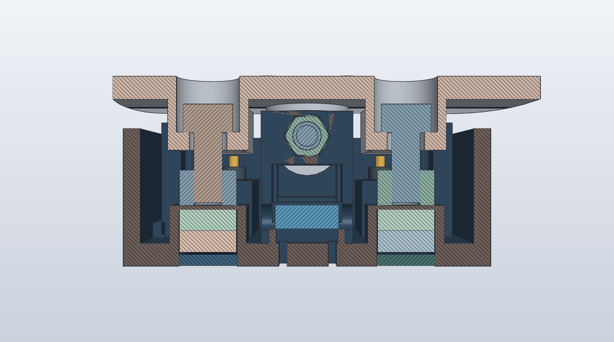
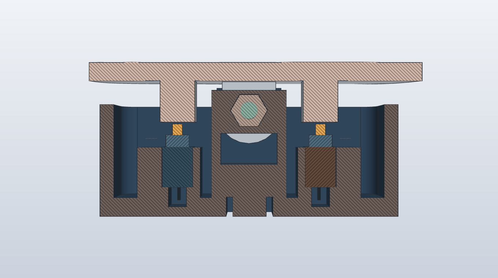

<!--more-->

## One paddle, both shifts

The original paddle on my F56 only pulls. I want the same blade to work in both directions: pull for one shift command, push for the other, with a distinct click and a return to center after each movement.

I used my paddle and wheel-area scans as references for a new SolidCraft prototype. The moving blade sits over a fixed box containing two switches, four small magnets and the resistors. I will mirror the printed parts for the other side of the wheel.

**Updated 11 November 2026.** The first version of this post showed a design centered by two springs. I have since replaced the springs with magnets and moved to a cheaper version of the same switch. The video, pictures and parts list below show the current design, and I have kept one of the old pictures to show the difference.

## What changed

| | First version | Now |
|---|---|---|
| Centering | Two opposed springs | Two pairs of magnets, each holding a steel nut |
| Feel | No resistance at neutral, rising to about 1.5 N at the stop | About 3.4 N to break away, falling to about 0.9 N at the stop |
| Neutral | Wherever the springs balance | A hard seat, set with two screws from the blade face |
| Switches | Omron D2HW-C201M, prewired, about $6.40 each | Omron D2HW-A201D, same sealed switch with pins, about $2.35 each |
| Switch mounting | M3 screw, nut and washer through a tab | Drop-in cradle and one small hold-down screw |
| Blade face | One opening, for the wheel screw | Three: the wheel screw and two adjusters |

The forces are calculated, not measured. Nothing has been printed yet.

{:.img-lg}
*Before: two coil springs, one beside each switch, push the blade back to center.*

{:.img-lg}
*Now: the springs are gone. A steel nut on each side sits on a pair of magnets. Pulling the blade lifts one nut (orange) while the switch on the other side closes.*

## Watch it assemble and click

The animation uses the actual CAD geometry of the current design. The switches and resistors go into the box, then the magnets load into their turrets from underneath. Bearings, shims and the two nut-carrying screws go into the blade, and that complete stack lowers onto the box. The two pivot screws go in last. The printed shells then become transparent so the magnets letting go and the individual switch actions are visible.



*The assembly paths are an exploded-view illustration. The click sounds are synthesized cues, not recordings of a finished paddle. The mechanism moves through its nominal CAD travel; this is not a physical test.*

## Small RC parts make a useful pivot

The pivot uses two **MR84ZZ bearings**, each 4 mm inside diameter, 8 mm outside diameter and 3 mm wide. They are ordinary miniature bearings sold for RC cars. **XRAY 372297** shims set the nominal stack on either side of each bearing.

{:.img-lg}
*The bearings sit in the blade. Two short shoulder screws support the pivot from opposite sides of the fixed box. The two taller screws carry the steel nuts for the magnets.*

The two short screws matter. A shaft running all the way across the box would block the center mounting screw. Keeping the middle open lets a T25 driver pass through the hole in the blade and into the original wheel fastener.

That BMW screw passes through the box and threads into the steering wheel. Its exact shank, head and under-head length still need measuring before I finalize the mounting bore and engagement.

## Magnets instead of springs

A spring pushes harder the further you compress it. With two opposed springs the blade had no real neutral and no snap: the resistance started at nothing and built up toward the stop.

A magnet pulling on steel does the opposite. The pull is strongest when the two are touching and falls away quickly as they separate. That is the feel I want: the blade holds still until you mean it, then lets go and snaps to the switch.

{:.img-lg}
*Calculated at a 30 mm lever arm. Expect the real magnets to give somewhat less than the model.*

Each side of the box has two **8 × 3 mm disc magnets** stacked in a chamber, closed on top by a 0.6 mm printed skin. In the blade, an **M4 screw** hangs through a hole with a **steel M4 locknut** on its end. The nut sits on the skin, held down by the magnets.

{:.img-lg}
*Section through both magnet stations. The pull-off load bears on the printed skin, not on glue, and the magnets never take an impact.*

When the blade turns, the side that rises lifts its screw by the head and pulls that nut off its magnets. The side that goes down slides along its own screw, which stays where it is. Letting go, the lifted nut is pulled back until it lands again, and that landing is the neutral position.

Both screws are reached through the blade face with a hex key, so any play at neutral can be adjusted out with the paddle assembled. The feel can be changed without reprinting: one magnet per side gives about 2.1 N to break away, two stronger N52 magnets about 4.3 N.

The nuts must be ordinary zinc-plated steel. Stainless locknuts are not magnetic and will not work.

## What happens during a click

Pulling the blade lifts one nut off its magnets and presses the switch plunger on the opposite side. Pushing it works the other pair. The printed stops limit travel to roughly **6.5 degrees each way** and are intended to take the end-of-travel load before the switch bottoms out.

The electrical intent is unchanged: a separate **6.5 kΩ path to ground for each direction**. Both channels should be open at neutral. The connector pinout, signal current and physical upshift/downshift assignment still need checking against the car.

## The same switch for a third of the price

The first version used the Omron **D2HW-C201M**, a sealed switch with factory wires and a screw-mount tab, at about $6.40 each. The **D2HW-A201D** is the same mechanism with the same click heights and the same long stroke, but with bare pins and no tab, at about $2.35 each. For a pair of paddles that is four switches for about $9 instead of about $26.

{:.img-lg}
*Each switch drops into a cradle and its pins hang into a well in the floor, where the wires are soldered on. One small screw holds it down.*

I also tried a mouse-type switch, which is even easier to buy. It has only a quarter of a millimetre of spare stroke after the click, so it needed an adjusting screw over each switch. The long-stroke switch needs none, so I went back to it.

## Parts for one paddle

| Part | Quantity | Starting specification | Since the first version |
|---|---:|---|---|
| Printed housing and blade | 1 each | PAHT-CF; mirror for the other side | Changed |
| Printed magnet plugs | 2 | PAHT-CF | New |
| [Avid **MR84ZZ** bearings](https://www.avidrc.com/product/p/15/4x8x3-Metal) | 2 | 4 × 8 × 3 mm, non-flanged; also sold on [Amazon in packs of 10](https://us.amazon.com/Double-Shielded-Ball-Bearing/dp/B091MYK22R) | Same |
| [XRAY **372297** shims](https://monacorc.com/en/3029-372297-xray-alu-shim-4x6x10mm-10.html) | 4 | 4 × 6 × 1 mm; ten per pack | Same |
| **AMPG STR601M4X8** shoulder screws | 2 | 4 mm shoulder × 8 mm long, M3 thread; a similar screw is on [Amazon in packs of 5](https://www.amazon.com/Shoulder-Screw-M3x0-50x8mm-L-Pk5/dp/B01LY79TC9) | Same |
| M3 pivot locknuts | 2 | Check pocket fit and thread engagement | Same |
| **D2HW-A201D** microswitches | 2 | Sealed SPDT pin-plunger type with pins; from [electronics distributors](https://www.findchips.com/detail/d2hw-a201d/OMRON-Electronic-Components-LLC) | Changed |
| M2 × 8 pan head screws | 2 | One holds each switch down | New |
| 8 × 3 mm neodymium disc magnets | 4 | N42 or stronger; [K&J D52](https://www.kjmagnetics.com/d52-neodymium-disc-magnet) or [Amazon packs](https://www.amazon.com/8x3mm-n52-magnets/s?k=8x3mm+n52+magnets) | New |
| M4 × 10 socket head screws | 2 | Alloy steel; [Amazon](https://www.amazon.com/clp/B015A351WS) | New |
| M4 nylon-insert locknuts | 2 | Zinc-plated steel, not stainless; [Amazon](https://www.amazon.com/Carbon-Plated-Threads-Self-Locking-M4-0-70/dp/B000NBKLKA) | New |
| 6.5 kΩ resistors | 2 | One per channel; verify package and power rating | Same |
| Original BMW mounting screw | 1 reused | T25 drive; dimensions to confirm | Same |

No longer needed: the two **LC 018B 05 M** springs, and the M3 × 16 screws, washers and plain nuts that held the first switches.

The pair needs twice these quantities; one ten-pack of the XRAY shims covers both paddles. Heat-shrink, strain relief and the correct wiring terminals complete the electrical assembly. The shoulder screws are not ordinary M3 × 8 screws—the smooth bearing surface is **4 mm** in diameter. I found the Amazon listings by search and have not ordered from them.

## Printing and the next fit check

I print PAHT-CF with ASA supports on my X2D. The box, the blade and the two small plugs will be separate prints, assembled around the metal hardware. The housing measures **38 × 52 × 23 mm**; the blade spans about **116 × 61 mm**.

The exported solids are valid and all three printable meshes are watertight. A modeled **8 mm driver** clears the center access path, the housing/blade motion check reaches the stops in both directions, and the magnet hardware stays clear of the blade at both stops. Those checks establish the digital geometry, not the fit or strength of a printed assembly.

Next is a bench print. The thin skin over each magnet chamber is the detail to prove first, because its thickness sets the click force. Then: check the bearing seats and small retaining lips, measure the real breakaway force, set the neutral, and verify that each switch releases cleanly. The wheel mounting surface and anti-rotation fit also need checking. Once those details are right, I can test the complete assembly and its wiring on the car.
