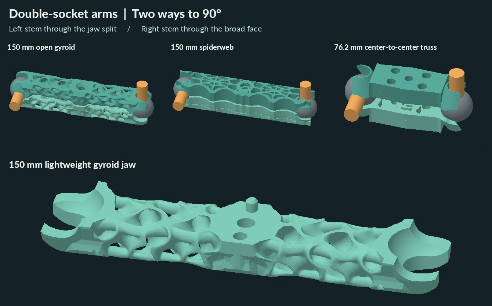
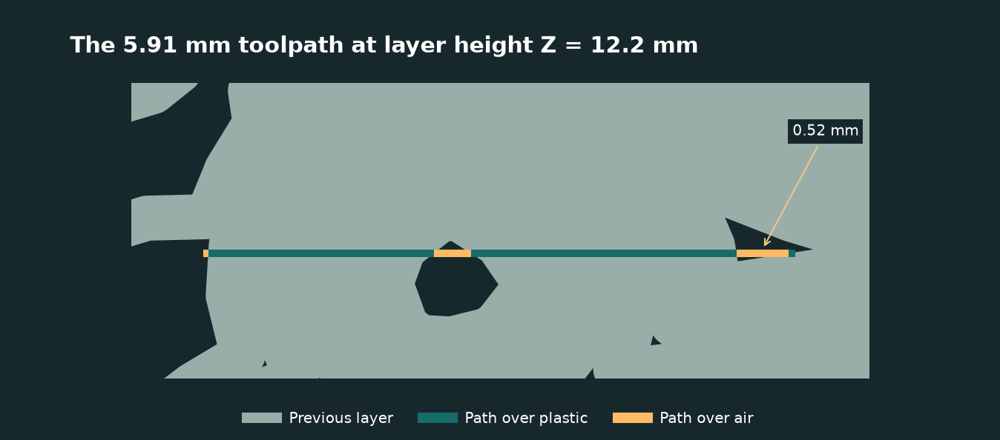
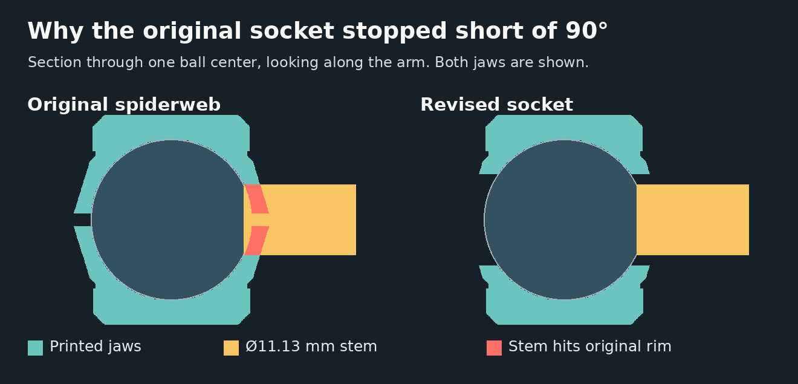
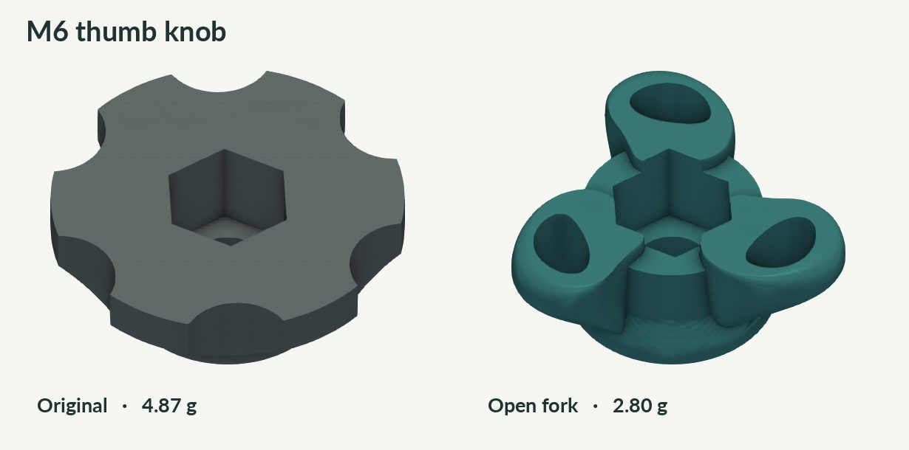
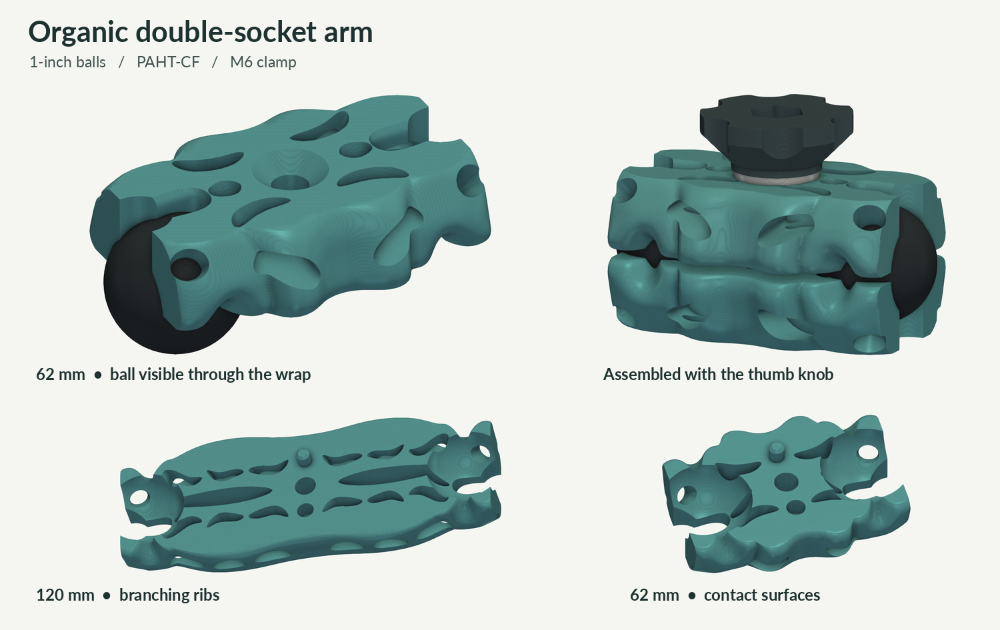
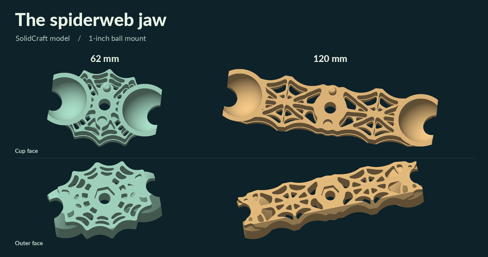

I wanted a lighter arm for my Samsung tablet in its RAM case. Could the ribs around a single clamp bolt do the job? We opened up a 62 mm double-socket arm, then pulled on its outer cup in a simulated bend test. The first crack and the final break happened at opposite ends.

<!--more-->

## A 150 mm gyroid arm with two ways to reach 90°
{: #dual-pivot-gyroid}

The exposed gyroid is my favorite shape so far. Its curved sheet runs between the screw boss and the two ball seats. I also opened the broad face of each socket. On both the new gyroid and spiderweb jaws, a 12 mm stem on a 1-inch ball clears the full swing from straight to 90° through either the split or the broad face, at either end in CAD. Ball grip under load still needs a bench test.

{:.img-lg}

**For the lightweight 150 mm gyroid, print two copies of `Gyroid-light-jaw-print-2.stl`, sockets up.** Use the M6 × 45 mm countersunk screw and open-fork knob. The pack also includes the stiffer gyroid, the dual-pivot spiderweb and a shorter truss with 76.2 mm between ball centers. The short truss is a fit prototype. Its minimum modeled plate clearance is 0.27 mm, and it exceeded its tip-deflection target. [Download the print files and settings (ZIP)](https://github.com/MrBlahhhh/MrBlahhhh.github.io/releases/download/ram-dual-pivot-v1/RAM-dual-90-print-pack.zip) · [Download the SolidCraft files and CAD generators (ZIP)](https://github.com/MrBlahhhh/MrBlahhhh.github.io/releases/download/ram-dual-pivot-v1/RAM-dual-90-source.zip)

### Will the open gyroid bridge cleanly?

One line in the slicer preview looked like a **5.91 mm bridge**. Following the nozzle across the layer underneath showed that the widest stretch of air on that line was only **0.52 mm**. A different line near the center screw boss crossed **5.39 mm** of air. Increasing the internal fill put plastic under that roof while keeping the visible lattice open.

{:.img-lg}

| Internal gyroid fill | Widest measured gap under a bridge-infill move | Filament per lightweight jaw, including supports and brim |
| --- | ---: | ---: |
| 40% | 5.39 mm | 26.60 g |
| 60% | 2.30 mm | 27.46 g |
| 80% | 1.34 mm | 28.30 g |

**I’d print the first jaw at 80%.** That costs 1.70 g over the original slice. I used a hardened 0.4 mm nozzle, 0.20 mm layers, 0.45 mm lines, five perimeters, bed-only snug supports and a 4 mm brim. All 101 model layers passed the isolated-start check. These gap measurements follow the centerline of each slicer-tagged bridge move over the previous layer’s nominal bead widths. Actual sag and support removal still need checking on a PAHT-CF print.

### What the edge reinforcement buys

<video controls playsinline preload="metadata" width="1000" height="550" style="width:100%;height:auto" aria-label="Simulated bending of three 150 mm gyroid jaws up to their first predicted tensile damage">
  <source src="/assets/images/spiderweb-tablet-mount/dual-pivot/Gyroid-bend-screen.mp4" type="video/mp4">
  <a href="/assets/images/spiderweb-tablet-mount/dual-pivot/Gyroid-bend-screen.mp4">Download the 150 mm gyroid bend video</a>
</video>

In the simulation, I held one ball seat fixed and loaded the jaw 50 mm past the other ball. The thin sheet alone reached first predicted tensile damage at **8.0 N per jaw**. Curved edge reinforcement raised that to **34.6 N** on the lightweight jaw. The stiffer gyroid reached **58.6–60.4 N** across two mesh sizes, close to the dual-pivot spiderweb’s **59.0 N**. The video shows true-scale elastic motion up to that threshold. Physical breaking loads remain unmeasured. [Download the 10-second bend video (MP4)](/assets/images/spiderweb-tablet-mount/dual-pivot/Gyroid-bend-screen.mp4)

## Getting the spiderweb arms to pivot 90°
{: #pivot-90}

The first 150 mm spiderweb arm clamped onto the ball, but when I swung the arm sideways on the mount, the stem hit the socket rim before the tablet reached the angle I wanted. I relieved the rim on both jaws at both ends. The stem can now swing out through the split on either side in the CAD assembly.

{:.img-lg}

The 1 inch measurement is the ball diameter. RAM’s aluminum diamond base has a **0.438 inch (11.13 mm) stem**. I swept that diameter and a larger **12 mm** stem from straight out to 90° at both ends. Both cleared through the full swing with the jaws 2 mm apart and again with the split narrowed to 1 mm. [RAM-B-238U dimensioned drawing](https://images.rammount.com/files/pdf/RAM-B-238U.pdf)

**All four lengths now have the 90° relief.** The original 62, 95 and 120 mm jaws bind the same way the 150 mm did, so I cut the same rim relief into them. Each passed the same sweep: both stem sizes, both jaw gaps, out through the split on either side at both ends. On every length the relief removes 27% of each cup’s spherical seat.

I also checked each jaw against the RAM diamond plate, a 48.6 × 33.4 mm diamond 19.6 mm below the ball center. The 95, 120 and 150 mm jaws clear it by at least 4.4 mm at any angle, however the diamond is turned. The 62 mm jaw is 42.9 mm wide, so its outer web sets the limit before the stem does. If the diamond’s long point runs along the arm, the web touches the plate at about 87°. If it runs across the arm, the jaw reaches 90° with 0.9 mm to spare.

**For the 90° version, print two identical jaws of the length you need** with the flat washer face on the bed and the cups up. Reuse the spiderweb arm’s M6 × 40 mm hex-head bolt, plain M6 nut, 18 mm washer and knob. Each ZIP includes the revised jaw STL, editable SolidCraft model, original knob STL and print instructions. [62 mm 90° pack](/assets/downloads/spiderweb-tablet-mount/Spiderweb-62mm-pivot90.zip) · [95 mm 90° pack](/assets/downloads/spiderweb-tablet-mount/Spiderweb-95mm-pivot90.zip) · [120 mm 90° pack](/assets/downloads/spiderweb-tablet-mount/Spiderweb-120mm-pivot90.zip) · [150 mm 90° pack](/assets/downloads/spiderweb-tablet-mount/Spiderweb-150mm-pivot90.zip)

### Did opening the sockets weaken the jaws?
{: #bend-test-150mm}

I ran the original and revised jaws through the same simulated bend test. I held the left cup fixed and applied a downward load 50 mm beyond the right ball. Watch the rib beside the fixed cup. It was the first place to show damage in both jaws.

<video controls playsinline preload="metadata" width="1280" height="600" style="width:100%;height:auto" poster="/assets/images/spiderweb-tablet-mount/150mm-bend-poster.jpg" aria-label="Side-by-side simulation of the original and 90-degree spiderweb jaws bending through peak load">
  <source src="/assets/images/spiderweb-tablet-mount/150mm-bend-comparison.mp4" type="video/mp4">
  <a href="/assets/images/spiderweb-tablet-mount/150mm-bend-comparison.mp4">Download the 150 mm bend-test video</a>
</video>

On the finer mesh shown in the video, first damage occurred at **60.68 N** on the original jaw and **60.34 N** on the revised jaw, about **0.6% earlier**. The revised jaw carried a higher peak on this mesh (64.42 versus 61.22 N), but the coarser mesh put both peaks within 0.04 N of each other. Across the two runs, opening the sockets showed no consistent loss in peak bending strength. [Download the 12-second comparison (MP4)](/assets/images/spiderweb-tablet-mount/150mm-bend-comparison.mp4)

I put the three shorter jaws through the same test. On every length, first damage started in a web rib, not at the opened rim.

| Length | Original peak | 90° peak | Change, finer mesh | Change, coarser mesh | Tablet travel at 3 g |
| --- | ---: | ---: | ---: | ---: | ---: |
| 62 mm | 143.1 N | 145.3 N | +1.6% | −1.6% | 0.302 → 0.296 mm |
| 95 mm | 96.1 N | 99.0 N | +3.1% | −5.6% | 0.838 → 0.839 mm |
| 120 mm | 86.0 N | 86.2 N | +0.1% | −0.8% | 1.763 → 1.769 mm |
| 150 mm | 61.2 N | 64.4 N | +5.2% | 0.0% | 3.508 → 3.523 mm |

Peaks are per jaw on the finer mesh. Travel runs from the original to the 90° jaw. The two mesh sizes disagree on the direction of the change, so I read the table as no consistent loss of strength at any length. Predicted travel at the tablet moved by 2% or less.

Grip is the remaining bench test. The relief removed **27% of the spherical seat area** from each cup. The simulation held the base cup fixed, so it leaves open how much torque the printed assembly can hold at 90° before the ball slips.

## Choose a thumb knob

The original knob has a scalloped rim. For the lighter version, I split the grip into three curved fingers around the same M6 nut pocket. Both fit the arm and use the same plain M6 hex nut and 18 mm washer. If you already printed the jaws, the knob is the only part you need to print.

{:.img-lg}

| Knob | PAHT-CF per print | Predicted twist under a single finger at 1 N·m | Print file |
| --- | ---: | ---: | --- |
| Original scalloped grip | 4.87 g | 0.06° | <a href="/assets/downloads/spiderweb-tablet-mount/M6-hand-knob.stl" download>Download original knob STL</a> |
| Open three-finger grip | 2.80 g | 0.22° | <a href="/assets/downloads/spiderweb-tablet-mount/M6-open-fork-knob.stl" download>Download three-finger knob STL</a> |

The open knob saves **2.07 g per print (42.5%)** in the same slice. The original is stiffer in the twist simulation. I also tried wider openings. They saved another 0.24 g, but one finger flexed about 73% more on the same mesh, so I kept the thicker roots. The printed knob still needs a hand-tightening test.

<video controls playsinline preload="metadata" width="1100" height="620" style="width:100%;height:auto" aria-label="Simulated single-finger twist of the wider-window knob followed by the selected three-finger knob">
  <source src="/assets/images/spiderweb-tablet-mount/Thumb-knob-twist.mp4" type="video/mp4">
  <a href="/assets/images/spiderweb-tablet-mount/Thumb-knob-twist.mp4">Download the knob twist comparison</a>
</video>

The video shows the wider-window trial first and the selected knob second, with movement enlarged 28×. Print either knob **washer face down, hex pocket up**. I used a 0.4 mm nozzle, 0.20 mm layers, five walls and 40% gyroid. The open fingers reach 0.61 mm farther from the screw axis, so check clearance through a full turn.

Starting from scratch? The 62 mm open-fork pack includes the reinforced jaw, the three-finger knob, editable SolidCraft files and both print guides. Print the jaw twice and the knob once. [Download the 62 mm open-fork arm and knob ZIP](/assets/downloads/spiderweb-tablet-mount/Open-fork-62mm-with-light-knob.zip)

## From spiderweb to organic wrap

The spiderweb put most of its openings **between** the two balls. For the next version I wanted the ribs to wrap **around** each 1-inch ball as well. Look at the black ball through the opening on the left. The curved fingers touch it on spherical pads. On the 62 mm jaw those pads retain about 74% of the contact area of the original solid cup. The new jaw is 46.5 mm wide across its broadest point, up from 42.9 mm on the spiderweb.

{:.img-lg}

### Where the extra material went

The first open jaw flexed at the shoulders where the sockets meet the arm. Widening those shoulders helped. Then a thinner version passed both whole-jaw bending tests, yet one finger still spread too far when loaded on its own. The stress map pointed to a small arc at its root. Thickening that arc brought its movement under the limit while using 0.70 g less filament per jaw than thickening the roots all around.

<video controls playsinline preload="metadata" width="1280" height="720" style="width:100%;height:auto" poster="/assets/images/spiderweb-tablet-mount/organic/rim-test.jpg" aria-label="Three simulated load tests of the 62 mm organic jaw, from the first rejected design to the reinforced rim">
  <source src="/assets/images/spiderweb-tablet-mount/organic/Load-test-highlights.mp4" type="video/mp4">
  <a href="/assets/images/spiderweb-tablet-mount/organic/Load-test-highlights.mp4">Download the organic load-test film</a>
</video>

| Time | What to watch in the 62 mm test |
| --- | --- |
| 0:00 | The first jaw bends 0.448 mm vertically. The limit was 0.230 mm. |
| 0:08 | The thinner wrap passes whole-jaw bending, but one socket rib moves 0.061 mm under 20 N. Its limit was 0.043 mm. |
| 0:20 | The reinforced rib moves 0.039 mm under the same force. The complete jaw passes all three flex checks. |

The film magnifies movement 45×. The readouts give actual predicted displacement. The limits allow each jaw to flex up to 25% more than the solid-cup reference. This film follows elastic movement under load. The [original spiderweb bend-to-fracture film](#original-spiderweb-bend-test) shows what happens as the simulated load keeps rising. [Download the 32-second comparison](/assets/images/spiderweb-tablet-mount/organic/Load-test-highlights.mp4) · [Download all 13 individual load-test videos](/assets/downloads/spiderweb-tablet-mount/organic/Load-test-videos.zip)

### Spiderweb and organic jaws compared

Each row compares one printed jaw at the same tip-to-tip length. Travel is the predicted vertical movement at the tablet under a 3 g load, assuming a 1 kg tablet and case centered 50 mm beyond the outer ball.

| Length | Spiderweb mass | Organic mass | Spiderweb travel | Organic travel |
| --- | ---: | ---: | ---: | ---: |
| 62 mm | 14.85 g | 19.44 g | 0.302 mm | 0.184 mm |
| 95 mm | 20.45 g | 31.11 g | 0.838 mm | 0.440 mm |
| 120 mm | 23.53 g | 40.81 g | 1.763 mm | 0.746 mm |
| 150 mm | 26.68 g | 54.10 g | 3.508 mm | 1.221 mm |

At 62 mm, the organic wrap costs an extra 4.59 g per jaw for about 39% less predicted vertical travel. All four organic sizes passed the simulated flex checks. The **95 mm** finger only just passed its local test at 0.09165 mm against a 0.09170 mm limit. The **62 mm** is my first bench prototype. Grip on the rubber balls, warm-cabin creep and physical breaking load still need testing.

### Print the organic wrap

Print two identical jaws and one thumb knob. The organic jaws take an **M6 × 1.0 × 45 mm, 90° countersunk socket screw**, measured including the head. Both versions use the same knob, plain M6 nut and 6.4 × 18 × 1.6 mm washer. The download includes the PAHT-CF print settings and assembly guide.

[62 mm organic starter pack](/assets/downloads/spiderweb-tablet-mount/organic/Organic-wrap-62mm.zip) · [Organic print files for all four lengths](/assets/downloads/spiderweb-tablet-mount/organic/Organic-wrap-print-pack.zip) · [Editable SolidCraft models for all four organic arms](https://github.com/MrBlahhhh/MrBlahhhh.github.io/releases/download/organic-wrap-v1/Organic-wrap-SolidCraft.zip)

## Original spiderweb bend test

<video controls playsinline preload="metadata" width="1344" height="768" style="width:100%;height:auto" poster="/assets/images/spiderweb-tablet-mount/Bend-test-poster.jpg" aria-label="Simulated bending of the 62 mm spiderweb jaw until the fixed cup separates">
  <source src="/assets/images/spiderweb-tablet-mount/Spiderweb-62mm-bend-test.mp4" type="video/mp4">
  <a href="/assets/images/spiderweb-tablet-mount/Spiderweb-62mm-bend-test.mp4">Download the bend-test video</a>
</video>

One jaw, with the left cup fixed and the load applied 50 mm beyond the right cup. The film shows bending at 2× scale. The graph shows calculated force and actual modeled travel. [Download the 18-second MP4](/assets/images/spiderweb-tablet-mount/Spiderweb-62mm-bend-test.mp4) · [Jump to the print files](#download-the-models)

## The first rib to go

The filmed mesh first reached the assumed tensile limit at **136 N on one jaw**, with 2.56 mm of load-point travel. The first damage was in a web rib beside the loaded cup. Several other ribs continued to carry load. The reaction peaked at **163 N** and then fell as damage spread. The fixed cup eventually tore away, leaving most of the web on the loaded side.

First damage is especially sensitive to how finely the thin rib is meshed. A finer mesh placed first damage in the same pair of rib-to-cup junctions, on the opposite side, at **77 N**. That gives me a place to watch during a bench test. The breaking force of an actual print and the load at which the rubber balls slip are still unmeasured.

## Spiderweb print files
{: #download-the-models}

Each ZIP contains the jaw STL, its editable SolidCraft model, the shared hand-knob STL and the print guide. Choose a **tip-to-tip jaw length**. All four use nominal 1-inch (25.4 mm) balls. Print the [90° versions](#pivot-90). The originals stay here in case you need to match a jaw you already printed.

| Length | Ball-center spacing | 90° pivot (print this) | Original |
| --- | --- | --- | --- |
| 62 mm | 46 mm | [Download the 62 mm 90° arm](/assets/downloads/spiderweb-tablet-mount/Spiderweb-62mm-pivot90.zip) | [Original](/assets/downloads/spiderweb-tablet-mount/Spiderweb-62mm.zip) |
| 95 mm | 79 mm | [Download the 95 mm 90° arm](/assets/downloads/spiderweb-tablet-mount/Spiderweb-95mm-pivot90.zip) | [Original](/assets/downloads/spiderweb-tablet-mount/Spiderweb-95mm.zip) |
| 120 mm | 104 mm | [Download the 120 mm 90° arm](/assets/downloads/spiderweb-tablet-mount/Spiderweb-120mm-pivot90.zip) | [Original](/assets/downloads/spiderweb-tablet-mount/Spiderweb-120mm.zip) |
| 150 mm | 134 mm | [Download the 150 mm 90° arm](/assets/downloads/spiderweb-tablet-mount/Spiderweb-150mm-pivot90.zip) | [Original](/assets/downloads/spiderweb-tablet-mount/Spiderweb-150mm.zip) |

[All four original sizes in one ZIP (105 MB)](https://github.com/MrBlahhhh/MrBlahhhh.github.io/releases/download/spiderweb-arms-v1/Spiderweb-tablet-arms.zip) · [Read the print and assembly guide](/assets/downloads/spiderweb-tablet-mount/Print-guide.txt)

For one arm, print **two identical jaws and one [M6 thumb knob of your choice](#choose-a-thumb-knob)**. The same knob fits all four lengths and holds a regular M6 hex nut. Each arm takes one fully threaded M6 × 1.0 × 40 mm external hex-head bolt, one regular M6 × 1.0 hex nut and one 6.4 × 18 × 1.6 mm flat washer. Print the jaws cup-side up, with the flat washer land on the bed. The comparison slice used PAHT-CF, a 0.4 mm nozzle, 0.20 mm layers, five walls and 40% gyroid.

In SolidCraft, **ArmLength** sets the tip-to-tip length. Start from the nearest preset. Each of the four downloads has its own optimized web. Editing the dimension stretches that geometry, so a custom length needs its own fit and stiffness checks. In the 90° models the rim relief follows **ArmLength**, and **PivotStemDiameter** sets the stem size it clears.

## Where the web came from

The short jaw barely has daylight between the cups and the M6 washer. Widening it from 35 to **42.9 mm** left room for curved ties around the bolt. Check that extra width if your mount sits close to the dash. The longer versions have room for a web on each side.

{:.img-lg}

The deeper spokes run into the cups. Shallow scalloped ties connect adjacent spokes. These views come directly from the printable meshes.

We gave a beam optimizer spokes, hoops and diagonal braces to choose from. It sized the members across four load cases under a fixed material budget. Eight candidate members dropped out of each size. The printable model gives the retained strands width, rounds their junctions and preserves the bearing surfaces for both balls and the clamp hardware.

## What the web costs

| Length | Original jaw | Smooth jaw | Spiderweb jaw | Spiderweb travel at 3 g |
| --- | ---: | ---: | ---: | ---: |
| 62 mm | 15.77 g | 13.02 g | 14.85 g | 0.30 mm |
| 95 mm | 24.51 g | 21.39 g | 20.45 g | 0.84 mm |
| 120 mm | 31.11 g | 26.71 g | 23.53 g | 1.76 mm |
| 150 mm | 39.04 g | 33.17 g | 26.68 g | 3.51 mm |

Each mass comes from slicing one jaw. The 62 mm web saves 0.92 g per jaw against the original. The smooth version uses 1.83 g less than the web and gives 0.20 mm of predicted travel at the tablet, versus 0.30 mm for the web. The 150 mm web saves the most filament and also bends the most.

{:.img-lg}

The service load applies 29.4 N to an assumed 1.0 kg tablet, case and adapter, shared equally between two jaws. The colors use the same von Mises stress scale in both images.

## What the film models

In the virtual fixture, one jaw bends as the remote load point moves downward. A finite-element solve redistributes the load after each group of failed elements loses stiffness. Peach faces mark newly exposed fracture surfaces. At the end, the rendering offsets the gold fragment by 4 mm so the break is visible.

The virtual print has stiff perimeter material and a softer infill core. The tensile criterion uses 92 MPa in the print plane and 47 MPa across the layers. Those values come from dry, annealed, solid coupons. The model omits fracture energy, interlayer shear failure, plasticity, temperature changes and large rotations. The first bench test will tell us how closely a printed web follows this sequence. [Bambu Lab PAHT-CF technical data sheet](https://store.bblcdn.eu/s8/default/91dea87af3414d878a0696d2c51b98f7/Bambu_PAHT-CF_Technical_Data_Sheet_V2.pdf)
