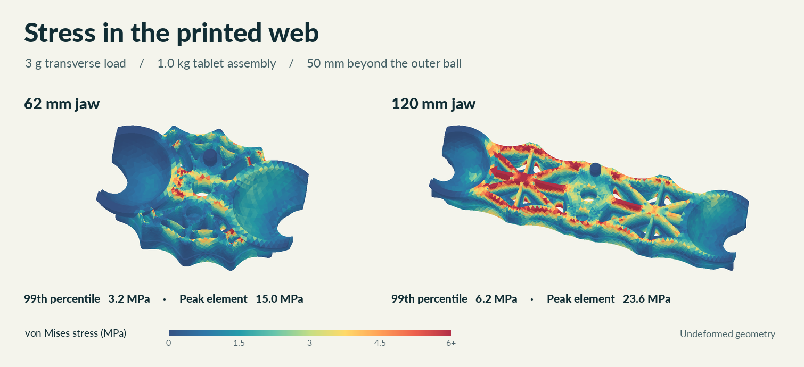

I wanted a lighter arm for my Samsung tablet in its RAM case. Could the ribs around a single clamp bolt do the job? We opened up a 62 mm double-socket arm, then pulled on its outer cup in a simulated bend test. The first crack and the final break happened at opposite ends.

<!--more-->

<video controls playsinline preload="metadata" width="1344" height="768" style="width:100%;height:auto" poster="/assets/images/spiderweb-tablet-mount/Bend-test-poster.jpg" aria-label="Simulated bending of the 62 mm spiderweb jaw until the fixed cup separates">
  <source src="/assets/images/spiderweb-tablet-mount/Spiderweb-62mm-bend-test.mp4" type="video/mp4">
  <a href="/assets/images/spiderweb-tablet-mount/Spiderweb-62mm-bend-test.mp4">Download the bend-test video</a>
</video>

One jaw, with the left cup fixed and the load applied 50 mm beyond the right cup. The film shows bending at 2× scale. The graph shows calculated force and actual modeled travel. [Download the 18-second MP4](/assets/images/spiderweb-tablet-mount/Spiderweb-62mm-bend-test.mp4) · [Jump to the print files](#download-the-models)

## The first rib to go

The filmed mesh first reached the assumed tensile limit at **136 N on one jaw**, with 2.56 mm of load-point travel. The first damage was in a web rib beside the loaded cup. Several other ribs continued to carry load. The reaction peaked at **163 N** and then fell as damage spread. The fixed cup eventually tore away, leaving most of the web on the loaded side.

First damage is especially sensitive to how finely the thin rib is meshed. A finer mesh placed first damage in the same pair of rib-to-cup junctions, on the opposite side, at **77 N**. That gives me a place to watch during a bench test. The breaking force of an actual print and the load at which the rubber balls slip are still unmeasured.

## Download the models

Each ZIP contains the jaw STL, its editable SolidCraft model, the shared hand-knob STL and the print guide. Choose a **tip-to-tip jaw length**. All four use nominal 1-inch (25.4 mm) balls.

| Length | Ball-center spacing | Files |
| --- | --- | --- |
| 62 mm | 46 mm | [Download the 62 mm arm](/assets/downloads/spiderweb-tablet-mount/Spiderweb-62mm.zip) |
| 95 mm | 79 mm | [Download the 95 mm arm](/assets/downloads/spiderweb-tablet-mount/Spiderweb-95mm.zip) |
| 120 mm | 104 mm | [Download the 120 mm arm](/assets/downloads/spiderweb-tablet-mount/Spiderweb-120mm.zip) |
| 150 mm | 134 mm | [Download the 150 mm arm](/assets/downloads/spiderweb-tablet-mount/Spiderweb-150mm.zip) |

[Download all four sizes together (105 MB ZIP)](https://github.com/MrBlahhhh/MrBlahhhh.github.io/releases/download/spiderweb-arms-v1/Spiderweb-tablet-arms.zip) · [Read the print and assembly guide](/assets/downloads/spiderweb-tablet-mount/Print-guide.txt)

For one arm, print **two identical jaws and one knob**. Each arm takes one fully threaded M6 × 1.0 × 40 mm external hex-head bolt, one regular M6 × 1.0 hex nut and one 6.4 × 18 × 1.6 mm flat washer. Print the jaws cup-side up, with the flat washer land on the bed. The comparison slice used PAHT-CF, a 0.4 mm nozzle, 0.20 mm layers, five walls and 40% gyroid.

In SolidCraft, **ArmLength** sets the tip-to-tip length. Start from the nearest preset. Each of the four downloads has its own optimized web. Editing the dimension stretches that geometry, so a custom length needs its own fit and stiffness checks.

## Where the web came from

The short jaw barely has daylight between the cups and the M6 washer. Widening it from 35 to **42.9 mm** left room for curved ties around the bolt. Check that extra width if your mount sits close to the dash. The longer versions have room for a web on each side.

{:.img-lg}

The deeper spokes run into the cups. Shallow scalloped ties connect adjacent spokes. These views come directly from the printable meshes.

We gave a beam optimizer spokes, hoops and diagonal braces to choose from. It sized the members across four load cases under a fixed material budget. Eight candidate members dropped out of each size. The printable model gives the retained strands width, rounds their junctions and preserves the bearing surfaces for both balls and the clamp hardware.

## What the web costs

| Length | Original jaw | Smooth jaw | Spiderweb jaw | Spiderweb travel at 3 g |
| --- | ---: | ---: | ---: | ---: |
| 62 mm | 15.77 g | 13.02 g | 14.85 g | 0.30 mm |
| 95 mm | 24.51 g | 21.39 g | 20.45 g | 0.84 mm |
| 120 mm | 31.11 g | 26.71 g | 23.53 g | 1.76 mm |
| 150 mm | 39.04 g | 33.17 g | 26.68 g | 3.51 mm |

Each mass comes from slicing one jaw. The 62 mm web saves 0.92 g per jaw against the original. The smooth version uses 1.83 g less than the web and gives 0.20 mm of predicted travel at the tablet, versus 0.30 mm for the web. The 150 mm web saves the most filament and also bends the most.

{:.img-lg}

The service load applies 29.4 N to an assumed 1.0 kg tablet, case and adapter, shared equally between two jaws. The colors use the same von Mises stress scale in both images.

## What the film models

In the virtual fixture, one jaw bends as the remote load point moves downward. A finite-element solve redistributes the load after each group of failed elements loses stiffness. Peach faces mark newly exposed fracture surfaces. At the end, the rendering offsets the gold fragment by 4 mm so the break is visible.

The virtual print has stiff perimeter material and a softer infill core. The tensile criterion uses 92 MPa in the print plane and 47 MPa across the layers. Those values come from dry, annealed, solid coupons. The model omits fracture energy, interlayer shear failure, plasticity, temperature changes and large rotations. The first bench test will tell us how closely a printed web follows this sequence. [Bambu Lab PAHT-CF technical data sheet](https://store.bblcdn.eu/s8/default/91dea87af3414d878a0696d2c51b98f7/Bambu_PAHT-CF_Technical_Data_Sheet_V2.pdf)

[Download the bend-test meshes, solver and force–travel data](/assets/downloads/spiderweb-tablet-mount/Bend-test-analysis.zip) · [Download the topology optimization and four-size structural analysis](/assets/downloads/spiderweb-tablet-mount/Topology-and-analysis.zip)
