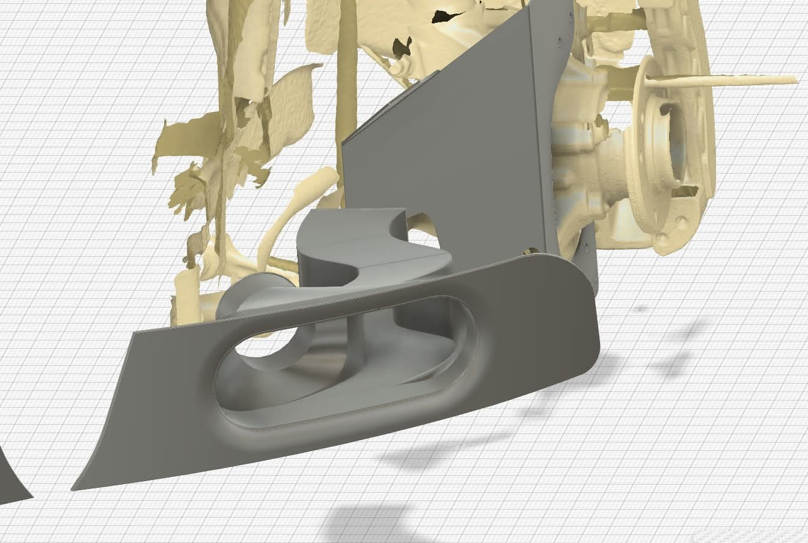
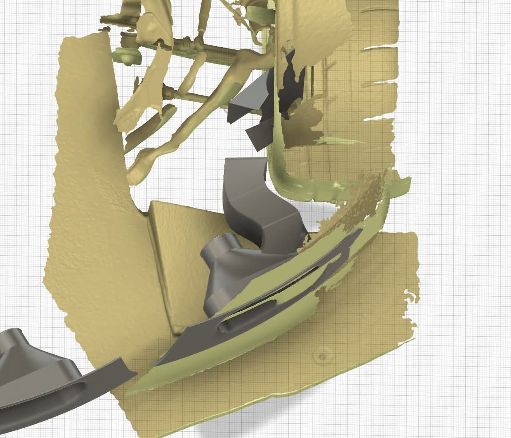
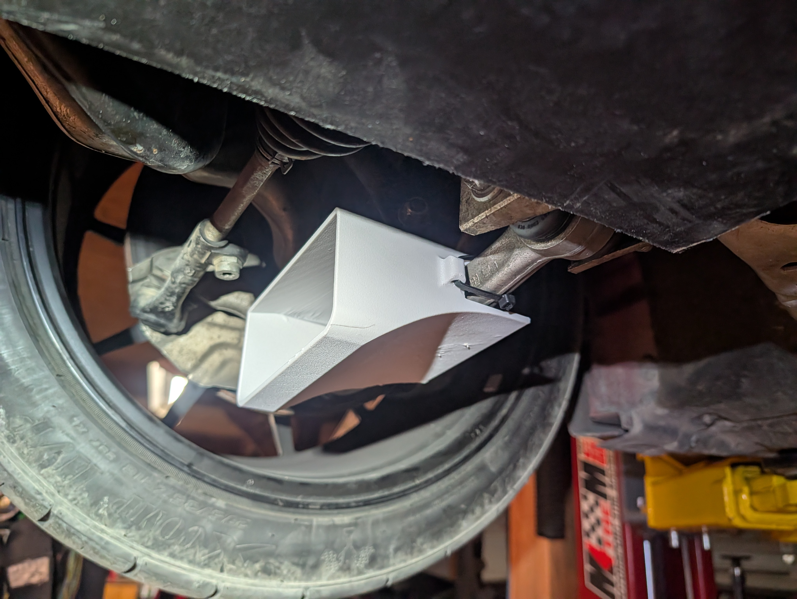
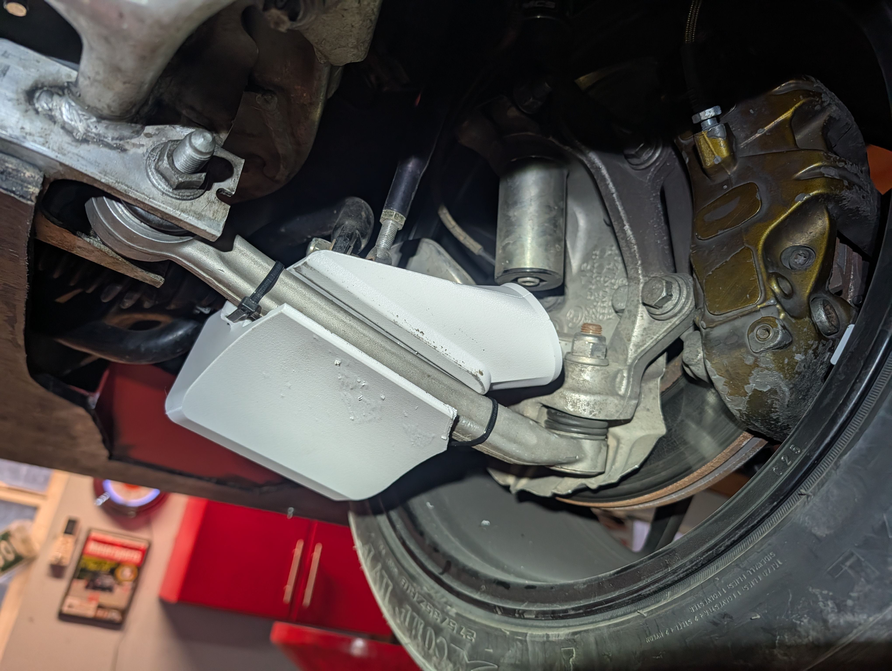
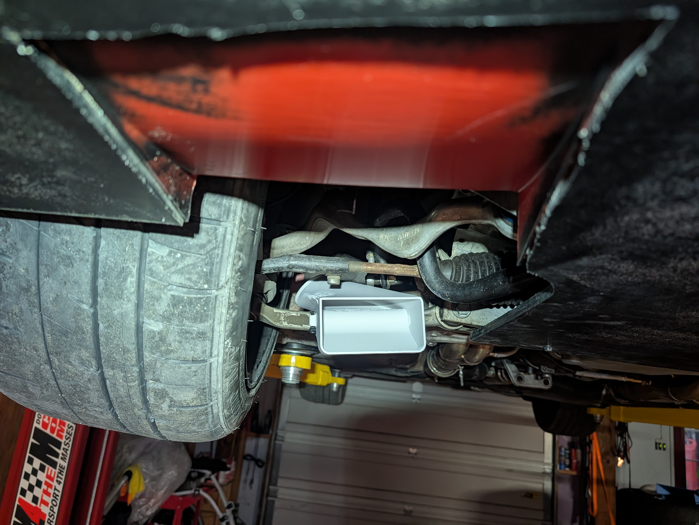
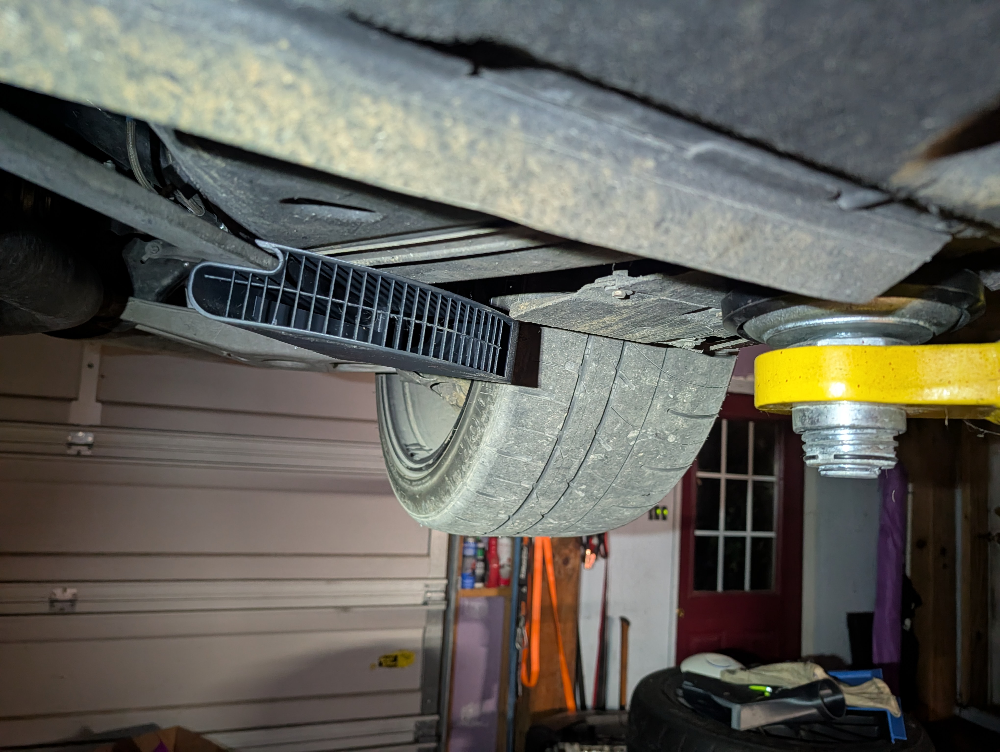
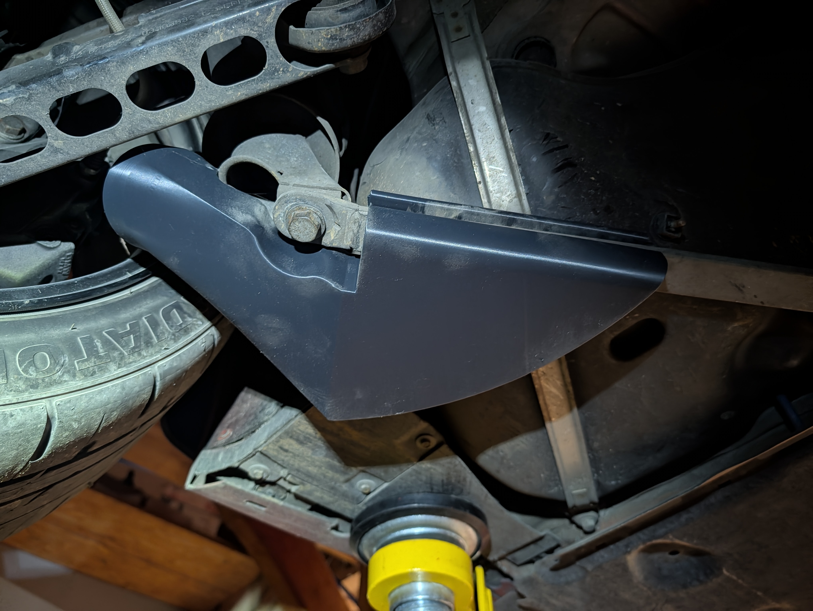
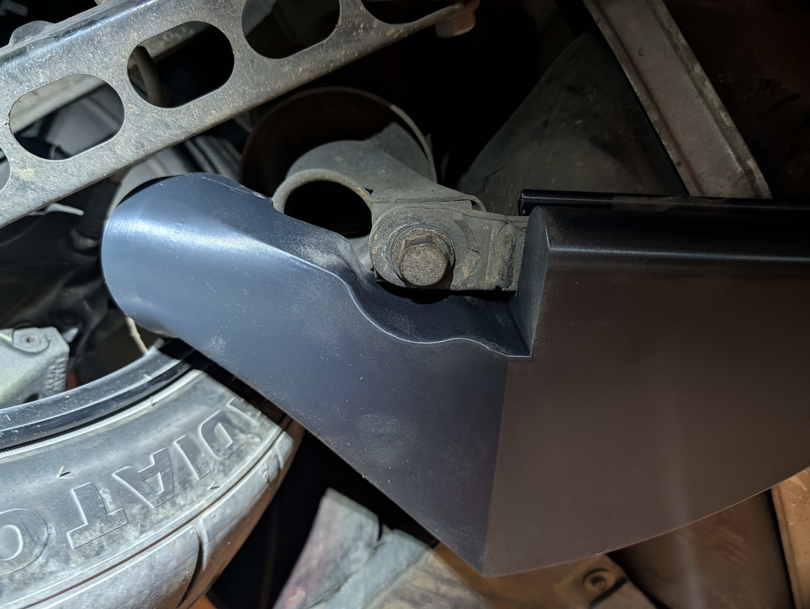
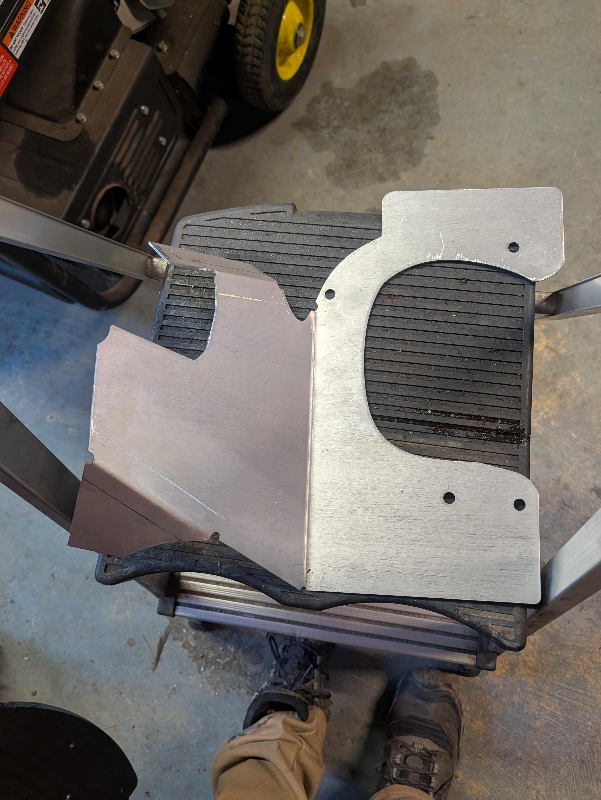
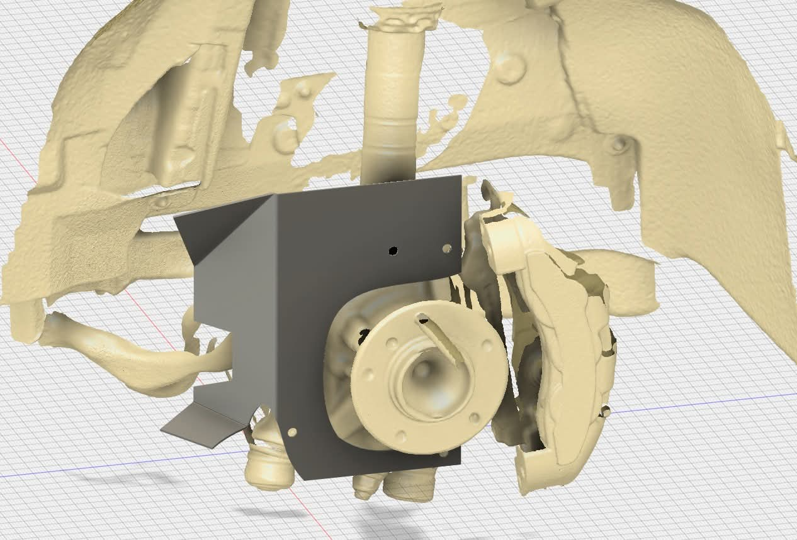

<iframe src="/135i-brake-ducts-3d/" title="135i brake ducts in 3D" loading="eager" allowfullscreen></iframe>

*Drag to orbit, scroll or pinch to zoom. The tabs switch between the whole front corner, the whole rear corner and the front arm duct on its own, with the air running through them. [Open the 3D view full screen](/135i-brake-ducts-3d/).*

<!--more-->

Printed brake cooling ducts for the E82 135i, front and rear, designed around a 3D scan of my own car and checked in CFD. Buy the STLs and print your own, or order a finished set and it'll be printed and shipped to you.

  <a href="#get-a-set">Get a set</a>
  <a class="alt" href="https://cults3d.com/en/3d-model/various/e82-bmw-front-control-arm-brake-cooling-duct">Front duct STL</a>
  <a class="alt" href="https://cults3d.com/en/3d-model/various/e82-rear-brake-ducts">Rear duct STL</a>

  
<h3>Front control-arm duct</h3>
209 CFM

through the duct at 100 mph in clean air. Rides on the arm, so the outlet stays on the caliper through travel.

  
<h3>Rear duct</h3>
225 CFM

through the duct at 100 mph in clean air. The rear gets no factory cooling at all, and this is the brake I used to cook.

  
<h3>Front air shields</h3>
Aluminum

flat blanks you bend yourself; they keep the ducted air on the rotor instead of washing into the wheel well.

## Why I built them

The brakes never faded on me. The heat cooked the hardware instead: I overheated the rears plenty of times, and in the end the **ceramic piston tips in the calipers broke up from the heat, front and rear**.

The E82 has cooling passages molded into the front bumper, but they only let air into the wheel well. Nothing aims it at the caliper. The rear gets nothing at all, which is why the rears were the ones that kept cooking. Molded kits cost hundreds and end in a hose you still have to route, so I modeled my own: a front duct on the control arm and a rear duct off the subframe, both with the outlet pointed straight at the caliper.

## Designed from a 3D scan

Both ducts were modeled against a **3D scan of my car's hub, arms and floor** (the tan mesh below), so they clear the real hardware through suspension travel instead of fitting a drawing.

{:.img-lg}
*The front duct (gray) drawn in place against the scan (tan), clearing the real arm and upright.*

{:.img-lg}
*The rear duct routed through the scanned subframe and floor. Every bend was checked against the real geometry before anything was printed.*

## The front duct

The front duct clamps to the lower control arm and puts a scoop out in the air ahead of the wheel. The body necks down and the outlet dumps straight onto the caliper.

Because it's on the arm, not the strut or the backing plate, it **moves with the suspension**, so the outlet stays on the caliper through the whole range of travel. A strap and the modeled-in saddle hold it on: no drilling into anything structural.

{:.img-md}
*Clamped to the control arm, mouth out in clean air ahead of the wheel.*

{:.img-md}
*The outlet tucked in behind the wheel, aimed at the caliper.*

{:.img-md}
*From underneath: the neck-down from mouth to outlet speeds the air up onto the caliper.*

## The rear duct

The rear duct takes air through a wide finned mouth under the floor and sweeps it round to the caliper off the subframe, tucked in among the rear links. The mouth is a nod to the **Ford Mustang GTD**, which feeds its rear brakes the same way, scaled and reshaped to fit under the 135i.

{:.img-md}
*The finned mouth sits below the floor, ahead of the rear tire.*

{:.img-md}
*It picks up on the subframe hardware: no brackets to make.*

{:.img-md}
*The outlet nozzle, pointed at the rear caliper.*

## Front air shields

A duct only helps if its air stays on the rotor. The **air shields** are aluminum plates that mount at the hub and keep the ducted air across the rotor face instead of letting it spill into the wheel well. They come as flat laser-cut blanks (I use [Send-Cut-Send](https://sendcutsend.com/)) that you bend to shape. I printed one first as a fit check and a bending former.

{:.img-md}
*The flat aluminum blank, bent by hand. The big radius clears the hub and the tab forms the air dam.*

{:.img-lg}
*Drawn over the hub against the scan, boxed round the back of the rotor with the caliper cleared.*

More on them in the [air shields post](/car/tech/2026/07/26/135i-front-brake-air-shields.html).

## What the CFD shows

Each duct went through a wind tunnel simulation at 100 mph, built from the same scans the parts were designed against, with the suspension put back at ride height. The 3D view at the top is those runs: pick a duct tab and tick "Only air through the duct" to see just the air each one takes in.

| Duct | Air through it at 100 mph |
|------|---------------------------|
| **Front control-arm duct** | 209 CFM |
| **Rear duct** | 225 CFM |

The flow is measured on cross-sections inside each duct, and the sections agree within 1%. The front corner tab is the whole front corner of my car at 125 mph, with the air running through it: bumper duct, splitter with its end plates and ramps, fender flares, the arm duct, the air shield and the brake.

## Fitment

- The front duct fits the **E82 / E88 135i** front lower control arm, which much of the E9X family shares.
- The rear duct fits the **E82** rear subframe.
- Both mount with straps and modeled-in saddles. **No drilling into anything structural.**
- Clears **17×10** and **18×10** wheels.
- Takes standard **3 in brake hose** if you want to feed the front mouth from a bumper inlet, or run it as a scoop.

## How they've worked out

They work. The cooling has **noticeably extended pad and rotor life**, and the piston tips haven't failed since.

With this much air on them, the brakes can squeak on tracks without heavy braking zones, where the pads never get up to temperature. On a track with real braking zones that goes away.

{:.img-lg}
*#78 out at a wet weekend.*



*#78 on track.*

## Get a set

### Printed and shipped

Printed to order on a **Bambu Lab H2S** and shipped to you, priced per pair (both sides of the axle):

| Set | ASA | PAHT-CF |
|-----|-----|---------|
| **Front pair** | **$100** | **$120** |
| **Rear pair** | **$150** | **$175** |
| **Full car** (front + rear) | **$250** | **$295** |

**ASA** is the standard UV-stable choice. **PAHT-CF** is the black, maximum heat resistance option. Shipping is billed at cost. Email [**ryan3ddesigns@gmail.com**](mailto:ryan3ddesigns@gmail.com?subject=135i%20brake%20ducts%20order) with the sets and material you want and your zip code, and you'll get a quote back.

### Print your own

| Part | Files |
|------|-------|
| **Front control-arm brake cooling duct** | [Cults3D](https://cults3d.com/en/3d-model/various/e82-bmw-front-control-arm-brake-cooling-duct) |
| **Rear brake ducts** | [Cults3D](https://cults3d.com/en/3d-model/various/e82-rear-brake-ducts) |
| **Front brake air shields** (flat aluminum blanks) | [Cults3D](https://cults3d.com/en/3d-model/tool/e82-135i-front-brake-air-shields) |

They live under the car in road grime, rotor heat and sun, so print them in a heat- and UV-tolerant material like ASA or PAHT-CF, not PLA. Dark colors hide brake dust.

{:.img-lg}
*Off the plate: a finished front duct, and a rear duct with its supports still on.*

## The fine print

- **Track use only.**
- **No warranty.** It's a printed part under a moving car next to hot brakes. Check it and its straps at every event, like any other duct or heat shield.
